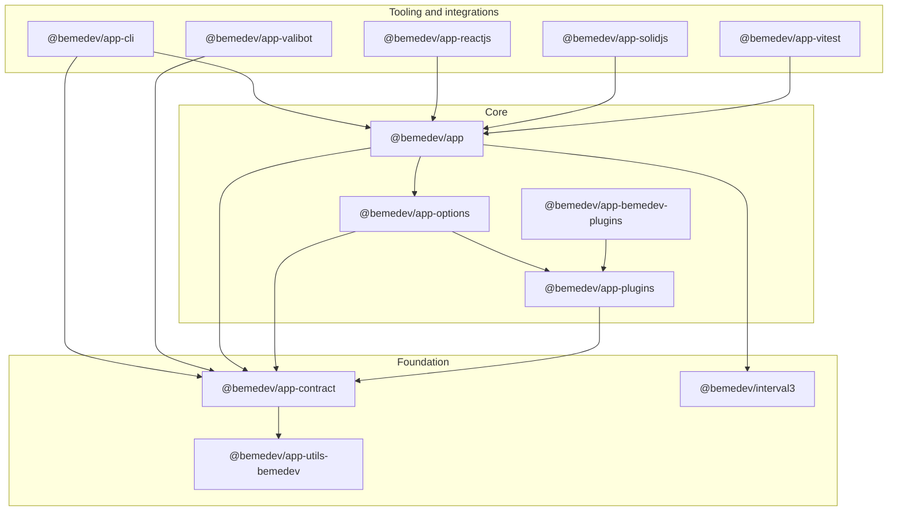

# @bemedev/app

A TypeScript monorepo for building **finite state machines** with a fully type-safe,
declarative API. Machines are written as pure data (states, transitions, guards,
actions), implementations are provided separately, and the typing surface is derived
from a **contract** — the single source of truth for the whole family.

The workspace ships ten published libraries, split by responsibility: a core runtime,
a contract layer, option and plugin helpers, framework bindings, and tooling for
generation, validation and tests.

## The 10 libraries

| Package                        | Location                   | Role                                                                                                                                                             |
| ------------------------------ | -------------------------- | ---------------------------------------------------------------------------------------------------------------------------------------------------------------- |
| `@bemedev/app`                 | `packages/app`             | Core library: `createMachine`, `interpret`, actors, emitters, delays, guards. Also re-exports the options and plugins APIs, so most users import from here only. |
| `@bemedev/app-contract`        | `packages/contract`        | Lightweight contract: machine config plus its typing surface, with **no** implementations. Self-contained and shareable with API layers.                         |
| `@bemedev/app-options`         | `packages/options`         | Contract-driven helpers that build the options object (`createOptions`, `buildHelpers`) without needing a machine instance. Re-exports the contract.             |
| `@bemedev/app-plugins`         | `packages/plugins/core`    | Plugin runtime and built-in addons (`createUtilities`, `same`). Plugins extend the utilities available to `createOptions`.                                       |
| `@bemedev/app-bemedev-plugins` | `packages/plugins/bemedev` | Optional plugins (currently `swap`) built on the plugin runtime. Opt in explicitly with `use`.                                                                   |
| `@bemedev/app-cli`             | `packages/cli`             | CLI and AST `parseTree` parser. Generates `app.gen.ts` / `app.contract.gen.ts`, registering machines and contracts in ambient types (`generate`, `watch`).       |
| `@bemedev/app-reactjs`         | `packages/reactjs`         | React hooks binding an interpreter service to components: `useService`, `useState`, `useCan`, `useIsInside`.                                                     |
| `@bemedev/app-solidjs`         | `packages/solidjs`         | SolidJS primitives mirroring the hooks as signals: `createService`, `createState`, `createCan`, `createIsInside`.                                                |
| `@bemedev/app-valibot`         | `packages/valibot`         | Valibot schemas validating machine configs (targets, node kinds, transitions, actions, guards, actors) before instantiation.                                     |
| `@bemedev/app-vitest`          | `packages/vitest`          | Declarative test-sequence generator for Vitest (`constructTests`), removing manual `await`/tick/assert boilerplate.                                              |

Two additional workspace packages support the ten above and are not published on
their own:

- `@bemedev/interval3` (`packages/interval3`) — cancellable interval whose delay is
  recomputed on every pass. It backs activities and delays in the `@bemedev/app`
  interpreter.
- `@bemedev/app-utils-bemedev` (`packages/utils/bemedev`) — internal type and utility
  kit (type helpers, `partialCall`, `toArray`, `trueO`, …). It is bundled into
  `@bemedev/app-contract` and re-exported from `@bemedev/app-contract/bemedev`.

## How they relate

Arrows mean "depends on / is built on top of":



Read bottom-up, the stack has three layers:

1. **Foundation** — `@bemedev/app-contract` holds the machine config and all derived
   types; `@bemedev/app-utils-bemedev` provides its type utilities and
   `@bemedev/interval3` provides the scheduling primitive.
2. **Core** — `@bemedev/app` interprets machines. Option building lives in
   `@bemedev/app-options`, which composes the plugin runtime from
   `@bemedev/app-plugins` (and optional plugins from `@bemedev/app-bemedev-plugins`).
   Both are re-exported by `@bemedev/app`, which is why a single dependency is enough
   for most projects.
3. **Tooling and integrations** — the CLI generates the ambient registrations
   consumed by the contract and core types, `@bemedev/app-valibot` validates configs,
   `@bemedev/app-vitest` tests services, and the React/Solid bindings expose state to
   component trees.

A typical flow:

```text
*.contract.ts  ──(app-cli generate --contract)──▶  app.contract.gen.ts
      │
      ▼
createOptions(contract).use(plugin)(...)   ──▶  options (actions, guards, …)
      │
      ▼
createMachine(config, types).provideOptions(...)  ──▶  machine
      │
      ▼
interpret(machine)  ──▶  service  ──▶  React / Solid bindings
                                    └─▶  Vitest sequences
```

## Repository layout

- `packages/` — the ten published libraries, plus `interval3`, `utils/` and the
  `__tests__/` integration suites.
- `apps/` — `reactjs` and `solidjs` demos, and `graph-app` for visualising machines.
- `vite.config.ts`, `vite.tasks.ts` — workspace-wide build, lint and test tasks, run
  through Vite+ (`vp`).

## Development

```bash
vp install          # install workspace dependencies
vp run pretest      # build the libraries
vp test             # run the test suites
vp check            # format, lint and type check
vp run ci           # full CI pipeline (install, pretest, lint, test, size)
```

Each package is built with `vp pack`; `vp run -r pack` builds them all.

## License

MIT
